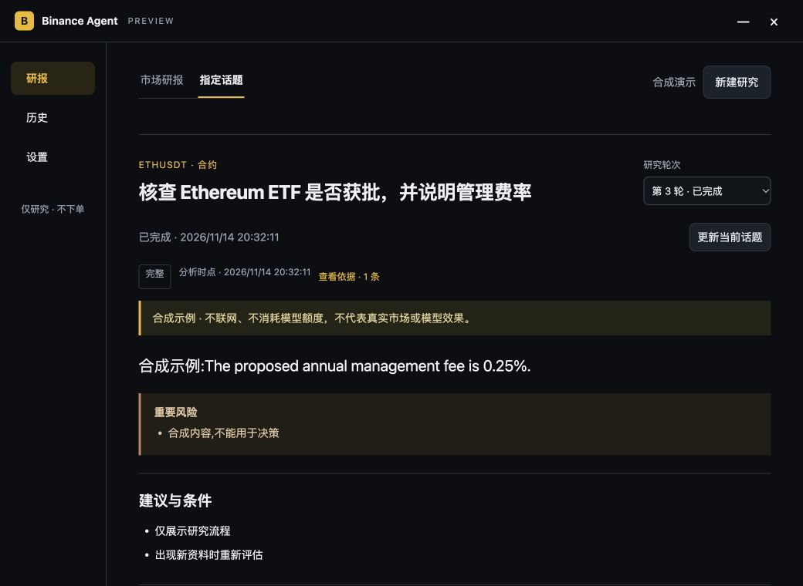

# Binance Agent

选择币种，点击“生成研报”，获得结论、条件性建议、关键依据与风险。也可以指定一个话题，持续研究行业、监管或宏观变化。

这是运行在本机的开源研究工具，**只分析，不下单**。

## 下载与首次使用

`0.3.0a1` 是未签名预览版，分发目标为 **Windows x64** 和 **macOS Apple Silicon arm64**。对应平台包、源码版本、SHA-256 与许可文件放在同一 GitHub prerelease 中。候选进度和实际验收证据见[发布计划](docs/release-plan.md)；仅以已发布 Release 为可下载版本。

1. 下载适合平台的包，解压到可写目录；macOS 将应用放到 Applications。
2. 打开“设置 → 模型连接”，选择服务，填写该服务的密钥与模型，保存后回到研究草稿。
3. 在“市场研报”选择币种与市场，点击“生成研报”。也可先查看明确标注的合成示例，不联网、不消耗模型额度。

预览包没有发行者签名，macOS 也未公证，系统可能显示来源或运行限制。请核对发布来源和 SHA-256，并按当前系统的逐应用提示操作；不要关闭全局系统防护。实际验证的系统版本写在 Release 说明中，不声明 Intel Mac 或 Windows ARM 支持。详细安装及构建说明见[打包文档](docs/packaging.md)。

## 两种研究方式

| 方式 | 你提供什么 | 你得到什么 |
| --- | --- | --- |
| 市场研报 | 币种、现货或合约市场 | 综合结论、条件性建议、主要依据、风险与再评估条件 |
| 指定话题 | 研究问题；可选关联币种 | 优先回答问题的专题报告，包含来源和未知事项 |

独立专题不需要币种，也不依赖 Binance 行情。关联币种的专题会带上资产范围。市场研报无需填写问题；切换入口会保留各自草稿。

结果先显示结论，支持阅读引用和已保存原文。**“证据不足”也是有效研究结果**：应用不会用模型记忆冒充刚检索到的证据，也不会为观察或不行动结论生成虚构价位。



## 继续研究与带走结果

- **新建研究**：新会话，与原话题隔离。
- **更新当前研报 / 话题**：原目标、新轮次，刷新资料。
- **继续追问**：在当前会话提出后续问题，生成新一轮。
- **运行中补充**：加入当前轮，区分“已接收”和“已纳入”。
- **恢复中断**：继续原轮，沿用已用预算与原截止时间。

结果自动保存在“历史”。轮次选择器可回看旧版本；“复制研报”和“保存 Markdown”导出当前查看的已保存结果，不再调用模型。桌面保存使用系统文件对话框，取消不会写文件。

## 模型、搜索与数据

模型由你连接的服务提供。公共资讯和官方来源默认可用，Tavily 搜索为可选项；没有搜索密钥也能开始研究。某来源失败时保留其他已有资料，并说明实际覆盖与缺口。

默认每轮最多 100 次请求、600 秒。请求数不是固定费用，实际账单由所选服务决定。代理、资料时间窗、数据源和桌面偏好在设置中；角色模型、并发和预算上限在高级设置。热键与置顶默认关闭。

密钥通过现有本地密钥存储保存，配置视图只显示是否已连接。研究和证据存于本地应用数据目录；模型、资料和搜索请求会发往你配置的外部服务。应用仅绑定 loopback，不是公网或多租户服务。详见[密钥说明](docs/secrets.md)。

## 从源码运行

需要 Python 3.10–3.12 与 uv；桌面依赖按当前系统安装。

```bash
uv sync --frozen --extra desktop --extra dev
uv run --frozen python -m binance_agent
```

完全离线的合成场景可这样体验：

```bash
uv run --frozen python -m binance_agent --profile demo
```

浏览器开发演示、测试、研究执行链和实验 CLI 见[开发者文档](docs/development.md)。产品约定见[PRODUCT.md](PRODUCT.md)，界面约定见[DESIGN.md](DESIGN.md)。

## 参与和许可

项目代码采用 [MIT](LICENSE)。[packaging/licenses](packaging/licenses) 保存补充许可正文和来源；完整依赖许可及分发清单随平台包提供。真实网页资料并不因此获得再分发许可。贡献方式见 [CONTRIBUTING.md](CONTRIBUTING.md)，漏洞反馈见 [SECURITY.md](SECURITY.md)。

本工具仅供信息研究，不构成投资建议。资料可能缺失、过期或错误；模型核验也可能失败。不承诺准确率、盈利能力或多 Agent 优势，不接入交易、仓位、账户或提现权限。
