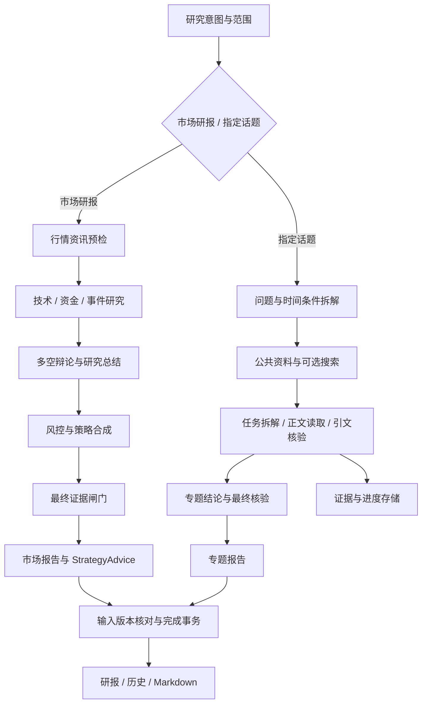

# 研究执行与报告

市场与专题共享父图、会话管理器、预算和 checkpoint。关联专题可以带上资产上下文；独立专题没有交易对，不进入行情或交易策略节点。市场报告直接整理已完成的策略结果，不增加改写模型。专题合成与核验计入同轮预算。

LLM 决定检索词、研究任务与解释，程序执行资料类型、费用、期限、引文存在性和最终发布约束。片段支持检查仍依赖模型，不等于外部事实真伪认证。任务局部缺口和分歧参与最终核验，未解决任务、阅读缺口或未核验结论不能标为完整报告。

专题的明确资料日期覆盖默认最近窗口，首尾日期均包含；支持日期参数的来源接收同一范围。RSS 和部分公共来源只提供有限历史，未知发布时间保留给正文核验，不能宣称覆盖全部历史。搜索只发现线索，正文仍走有界抓取和核验流程。

运行中补充递增输入版本，关闭过时执行流后沿用预算重算；旧工作保留内部审计记录。完成事务确认最新版本和补充已纳入后才发布报告。原文、消息、轮次与历史结果保持关联；详细 API、迁移和恢复语义见[持续研究会话](collaboration.md)。
